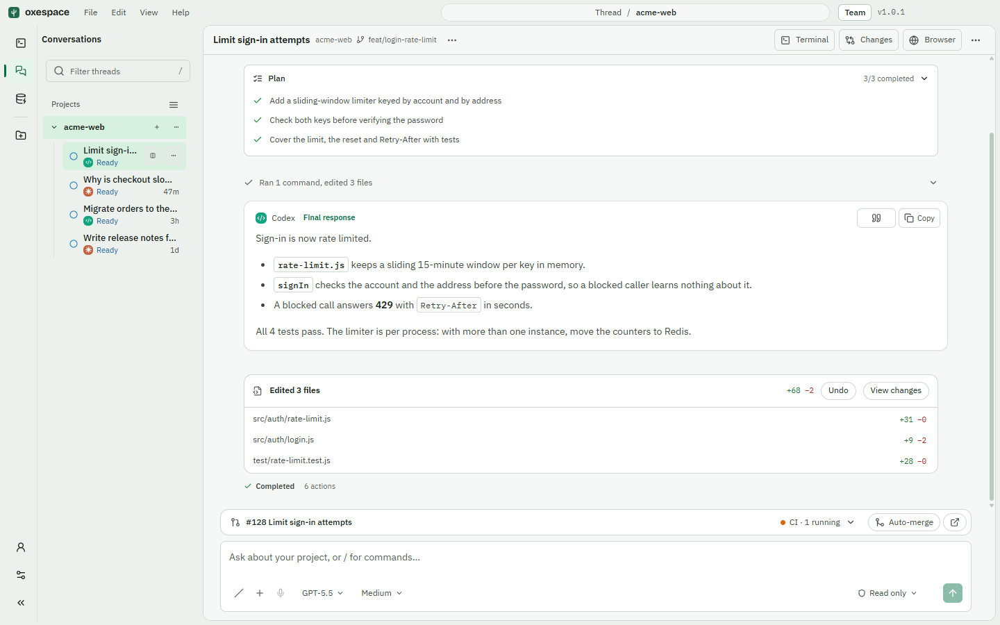
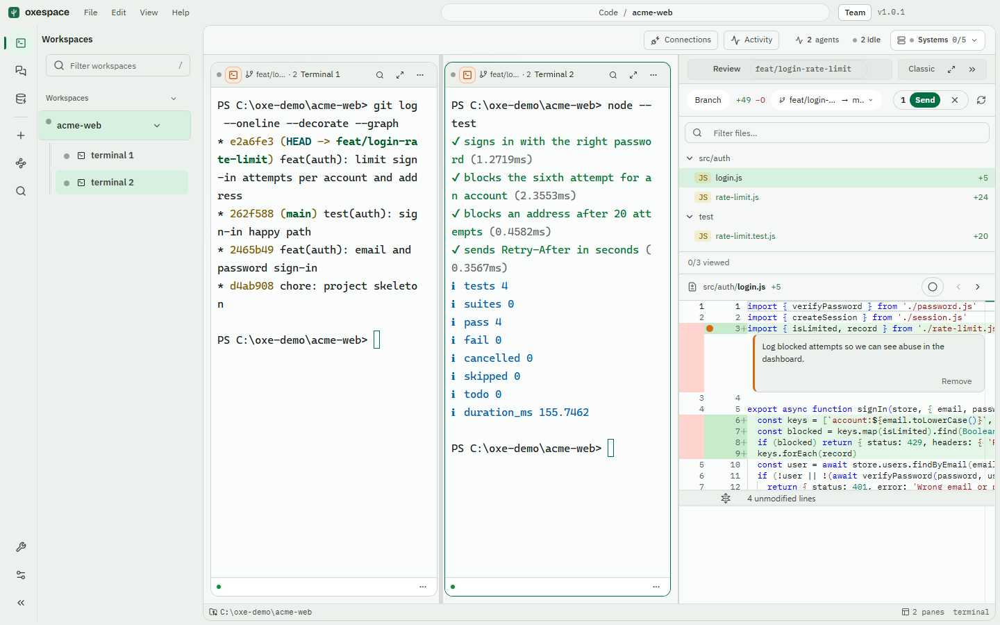
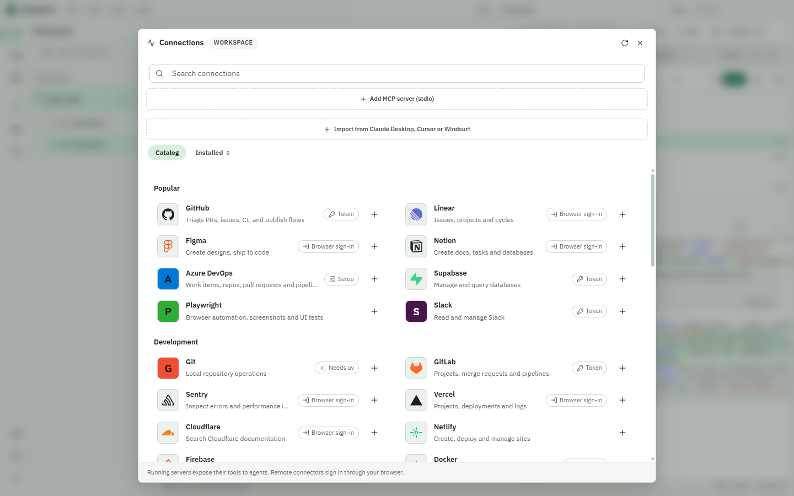
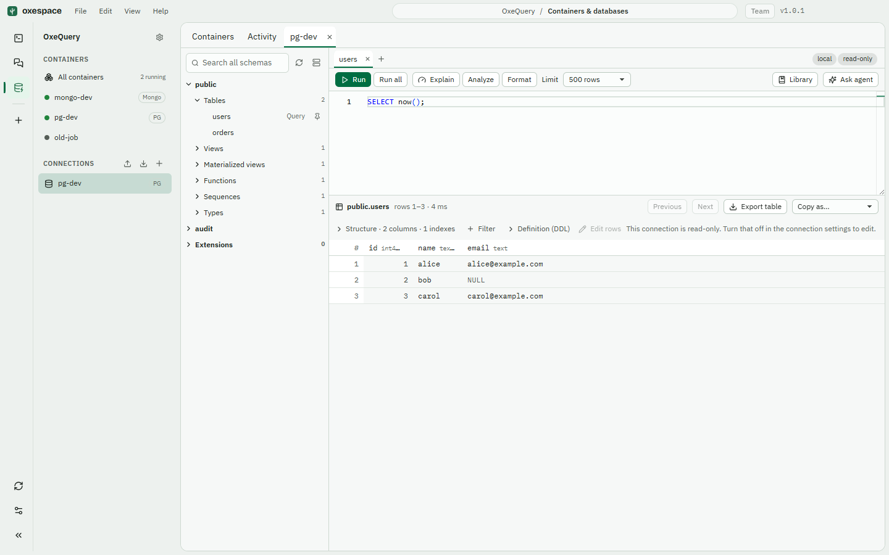

<div align="center">
  

  <h1>OXESpace</h1>

  <p><strong>A desktop workspace for working with coding agents — terminals, native Claude&nbsp;Code and Codex conversations, review, connectors and memory in one window.</strong></p>

  <p>
    <a href="https://github.com/propagno/oxespace/releases/latest"></a>
    <a href="https://github.com/propagno/oxespace/actions/workflows/ci.yml"></a>
    <a href="LICENSE"></a>
    
  </p>

  <p>
    <a href="https://github.com/propagno/oxespace/releases/latest"><b>Download</b></a> ·
    <a href="#install">Install</a> ·
    <a href="#what-you-can-do">Features</a> ·
    <a href="docs/PLATFORM_SPEC.md">Platform specification</a> ·
    <a href="docs/ARCHITECTURE.md">Architecture</a> ·
    <a href="CONTRIBUTING.md">Contribute</a>
  </p>
</div>

<br />

OXESpace is for people who already work with agents such as **Claude Code** and **Codex** and want one place to run them, watch what they do, review what they changed and give them the right tools — without giving up the terminal.

It runs entirely on your machine. Your repositories stay where they are, the agents are the official CLIs you already have signed in, and nothing is proxied through a service of ours.

<p align="center">
  <picture>
    <source media="(prefers-color-scheme: dark)" srcset="docs/assets/screenshots/thread-dark.png" />
    
  </picture>
</p>

## What you can do

### Three modes

| | **OxeCode** | **OxeChat** | **OxeQuery** |
|---|---|---|---|
| What it is | A grid of real terminals (PTY) per workspace | A native conversation with Claude Code or Codex | Containers, PostgreSQL and MongoDB in one place |
| Best for | Running any CLI, shells, dev servers, several agents side by side | Asking, planning and reviewing with approvals, questions, attachments and history | Seeing your Docker or Podman containers and querying and editing data safely |
| Agents | Claude Code, Codex, Copilot CLI, Cursor, Grok and any command you configure | Claude Code and Codex, using your own subscription sign-in | Optional MCP tools for agents, off by default and approved by you per statement |

Switch between them from the rail on the left; running terminals are preserved while you are in OxeChat. OxeQuery is the newest mode and has had less real-world use than OxeCode and OxeChat. See [OxeQuery](docs/OXEQUERY.md) for what it does and its current limits.

### OxeChat

- **Reads like a conversation, not a log.** Three transcript views — **Summary**, **Normal** and **Verbose** (`Ctrl+O`) — control how much of the agent's work is shown. Normal folds actions into one line such as *"Ran 4 commands, edited 2 files"*.
- **Review without leaving.** *Edited N files* cards open the **Changes** panel, offer **Undo** for the turn (via checkpoints) and send review comments back to the agent.
- **A prompt box that does the work.** `@` mentions project files, `+` attaches images or opens connectors, one control sets access and approvals, and a usage ring shows your plan allowance.
- **Questions and approvals are first-class.** Agent questions, command and tool approvals, plan approvals and background tasks have their own cards. Only a short read-only list (`ls`, `git status`, `grep` and the like, inside the project) and rules you saved are answered for you; the list can be turned off in Rules. Anything that writes, reads outside the project or uses the network asks. See the [approval review](docs/validation/thread-command-approval-security-review.md).
- **Pull request status in the conversation.** The branch's PR, its checks and a ready-made *Fix failing checks* prompt, plus auto-merge, through `gh`.
- **Terminal, Changes and Browser** are one click away (`Ctrl` + backtick, `Ctrl+Shift+D`, `Ctrl+Shift+B`); files, search, scripts and background activity live in the `⋯` menu.

### Review and Git

- **Changes** — a side-by-side Monaco diff of your branch against a base, with a file tree, *Viewed* marks, one-file-at-a-time mode for large diffs and **line comments** you can send to the agent.
- **GitHub hub** — status, branches, checkpoints, pull requests and releases using the GitHub CLI (`gh`).
- **Worktrees and delegation** — hand a task to an isolated worktree with its own persistent conversation.

<p align="center">
  <picture>
    <source media="(prefers-color-scheme: dark)" srcset="docs/assets/screenshots/code-review-dark.png" />
    
  </picture>
</p>

### Connectors (MCP)

A catalog of ready-to-add servers with brand tiles — **GitHub, Notion, Linear, Azure DevOps, Supabase, PostgreSQL, MongoDB, Playwright, Slack, Figma, Sentry, Stripe** and more.

- One click on `+` adds, trusts and starts a connector; remote ones open the browser sign-in for you.
- Servers you enable are attached to your OxeChat conversations and exported to the CLIs you use in OxeCode.
- Secrets are handed to servers through the environment, not the command line.
- Only servers you have explicitly trusted are ever exported.

<p align="center">
  <picture>
    <source media="(prefers-color-scheme: dark)" srcset="docs/assets/screenshots/mcp-catalog-dark.png" />
    
  </picture>
</p>

### OxeQuery

See your Docker or Podman containers, connect to PostgreSQL and MongoDB (also through an SSH tunnel), browse schemas, run queries, explain them and stage edits that are checked for conflicts before they are written. Connections are read-only until you say otherwise, and agents only get database tools you turn on. See [OxeQuery](docs/OXEQUERY.md).

<p align="center">
  <picture>
    <source media="(prefers-color-scheme: dark)" srcset="docs/assets/screenshots/oxequery-dark.png" />
    
  </picture>
</p>

### Context your agents can use

- **Local semantic search (CodeGraph)** — an on-device, multilingual index (SQLite FTS5, tree-sitter and an embedded `multilingual-e5-base` model) that works offline and under a strict token budget. See [Semantic retrieval](docs/SEMANTIC_RETRIEVAL.md).
- **Shared project memory (beta, opt-in)** — optional, local-first memory across worktrees; off until you turn it on. See [Project memory](docs/PROJECT_MEMORY.md).
- **Internal MCP bridge** — exposes workspace tools (search, scripts, worktrees, delegation, web preview, documentation) to the agents running inside OXESpace.

### Everything else in the box

Monaco editor and file tree · Find in Files (ripgrep) · scripts and background jobs · Web Preview with design mode · documentation capture and export · Linear integration · persistent agent Teams · voice dictation (Windows) · desktop notifications · command palette · 11 themes · runtime diagnostics with redacted support reports.

## Install

> **Status.** `1.0` is the first stable line. Stable installs never receive pre-releases, and the database is backed up before any migration. Long-term compatibility rules are still a [draft](docs/COMPATIBILITY.md); shared project memory is beta and off by default.

| Platform | Download | Updates |
|---|---|---|
| **Windows 10 or later, x64** | `OXESpace-<version>-x64.exe` (NSIS installer, per-user) | Automatic, from GitHub Releases |
| **Linux x64 — any distro** | `OXESpace-<version>-x64.AppImage` | Automatic when run as an AppImage |
| **Ubuntu / Debian x64** | `OXESpace-<version>-amd64.deb` | Reinstall the new `.deb` |

macOS packages are not published yet.

### Verify what you downloaded

Every release includes `SHA256SUMS.txt` and an SBOM per platform (`sbom-windows-x64.spdx.json`, `sbom-linux-x64.spdx.json`).

```powershell
# Windows
Get-FileHash .\OXESpace-<version>-x64.exe -Algorithm SHA256
```
```bash
# Linux
sha256sum -c --ignore-missing SHA256SUMS.txt
```

> **Windows SmartScreen.** The installer is not yet code-signed, so Windows may show *"Windows protected your PC"*. Compare the checksum above before choosing **More info → Run anyway**. Signing is tracked in the [stable-readiness study](docs/audits/2026-10-11-stable-readiness.md).

### Before the first run

| You need | For | Check |
|---|---|---|
| An agent CLI you can sign in to — **Claude Code** and/or **Codex** | OxeChat and the agent panes | Run it once in a terminal, or sign in from OXESpace |
| **[GitHub CLI](https://cli.github.com/)** | GitHub hub, pull-request status, releases | `gh auth login` |
| **Node.js 22+** | Running most MCP servers (`npx`) | `node --version` |
| `uv` (optional) | A few Python-based connectors | `uvx --version` |

Open OXESpace, add a project folder, and start in **OxeCode** or **OxeChat**. The account panel in OxeChat shows which providers are connected.

## Your data and your network

- **Local-first.** Workspaces, conversations, memory and indexes live in a SQLite database and files under your user profile; the semantic model ships inside the app.
- **No analytics or telemetry SDK** is bundled. The app talks to the network only for things you turn on: your agent CLIs and their providers, `gh`/GitHub, MCP servers you add, and update checks against GitHub Releases.
- **Hardened renderer.** Context isolation and sandboxing are on, file access is confined to the workspace root after canonicalisation, and diagnostics redact paths and credential-shaped values. Details: [Security model](docs/SECURITY_MODEL.md).
- **Verified releases.** Releases are produced by one pipeline that runs typecheck, lint, tests, build and end-to-end tests on Windows and Linux, then verifies the published payload before it goes live. See the [release pipeline](docs/RELEASE_PIPELINE.md).

What is stored, for how long, and exactly what goes over the network: [Privacy and data handling](docs/PRIVACY.md).

To report a vulnerability, follow [SECURITY.md](SECURITY.md).

## Build from source

```bash
git clone https://github.com/propagno/oxespace.git
cd oxespace
npm ci
npm run rebuild:native:electron   # SQLite and node-pty for Electron
npm run dev
```

```bash
npm run typecheck
npm run lint
npm run test:electron      # whole suite on the Electron runtime
npm run build
npm run test:e2e
npm run dist               # installer into dist/ (dist:linux on Linux)
```

Linux needs the toolchain and Electron runtime libraries listed in the [development guide](docs/DEVELOPMENT_GUIDE.md#linux-ubuntudebian-x64). `npm run verify:linux` reproduces the Linux CI leg from any Docker host.

## Documentation

| | |
|---|---|
| [Platform specification](docs/PLATFORM_SPEC.md) | Supported platforms, capabilities, limits, data locations |
| [Architecture](docs/ARCHITECTURE.md) | Processes, subsystems and boundaries |
| [OxeChat](docs/thread-view.md) | The conversation surface, commands and accounts |
| [Security model](docs/SECURITY_MODEL.md) | Trust boundaries and release controls |
| [Release pipeline](docs/RELEASE_PIPELINE.md) | How a version becomes a GitHub Release |
| [Development guide](docs/DEVELOPMENT_GUIDE.md) | Setup, tests and conventions |
| [Release notes](docs/releases) | What changed in each version |

## Contributing

Bug reports, ideas and pull requests are welcome — start with [CONTRIBUTING.md](CONTRIBUTING.md). Please use [issues](https://github.com/propagno/oxespace/issues) for questions and bugs, and [SECURITY.md](SECURITY.md) for anything security-sensitive.

## License

[MIT](LICENSE) © 2026 propagno
