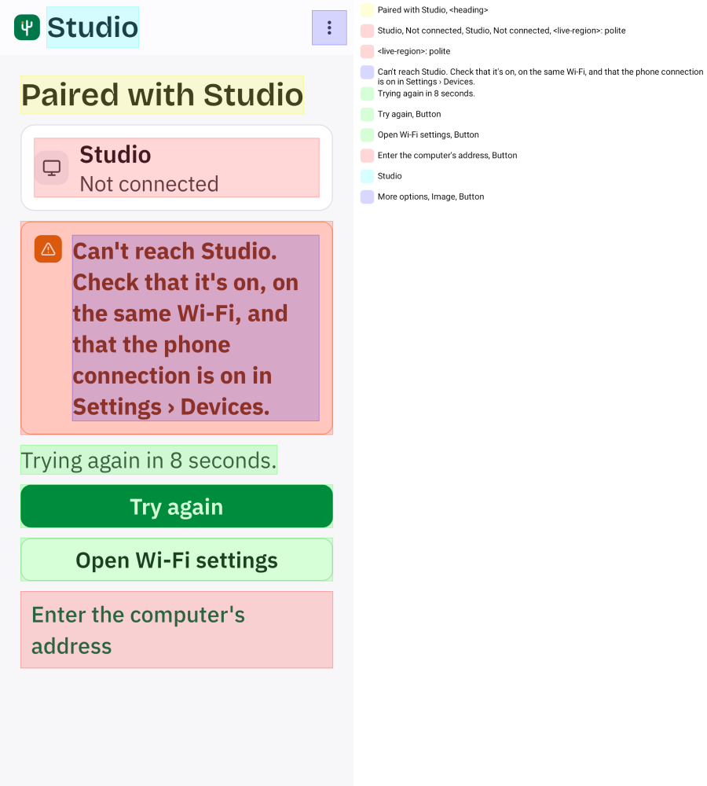
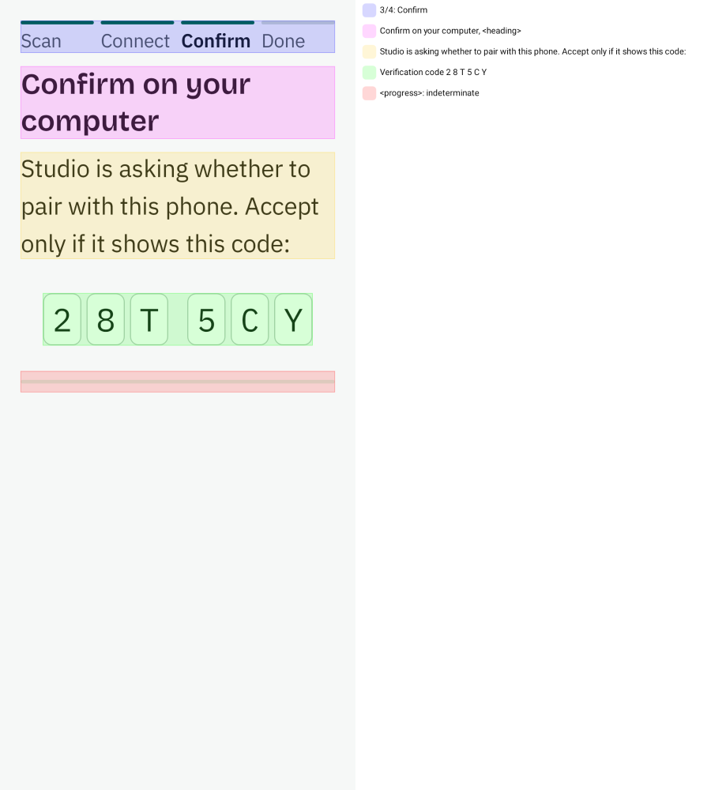
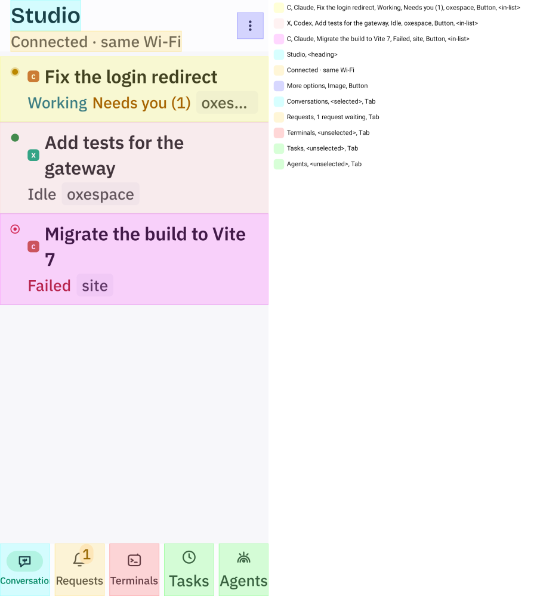
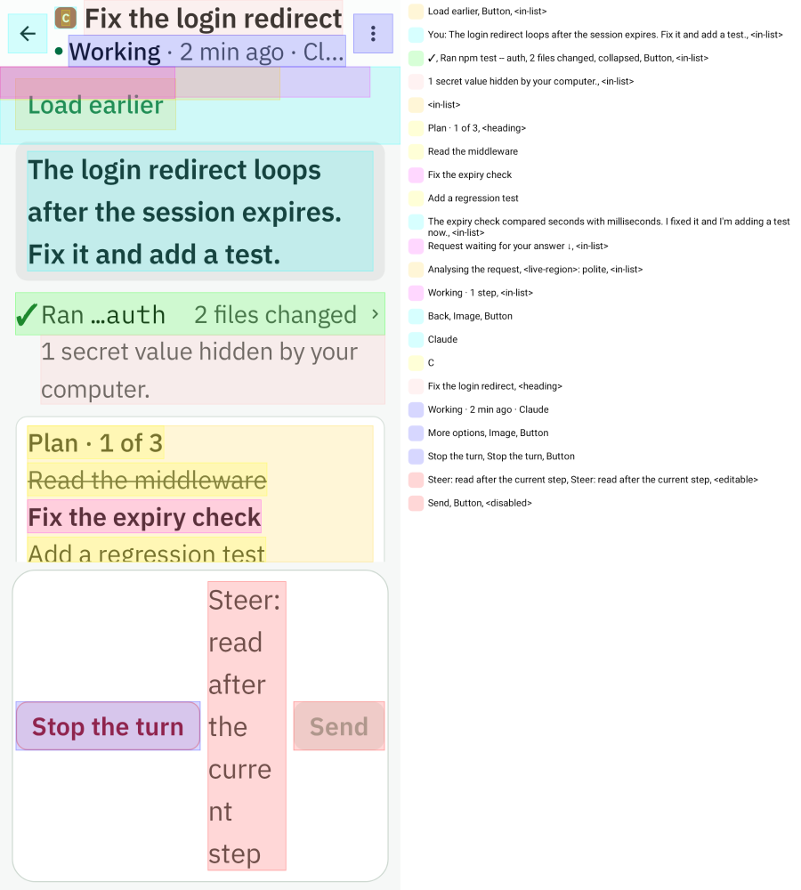
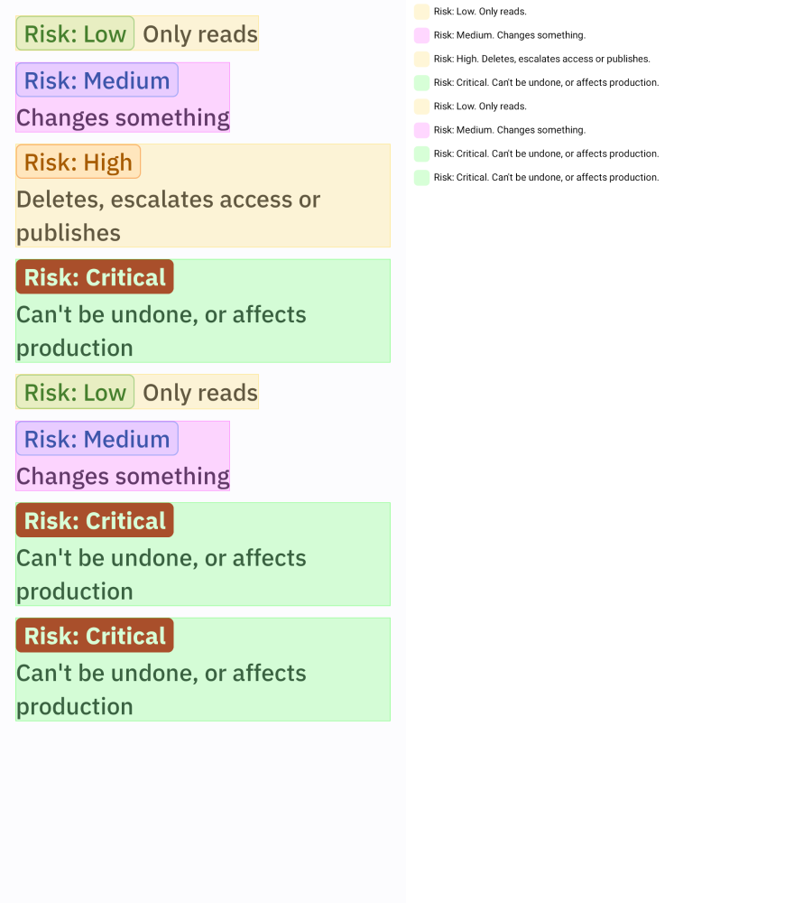
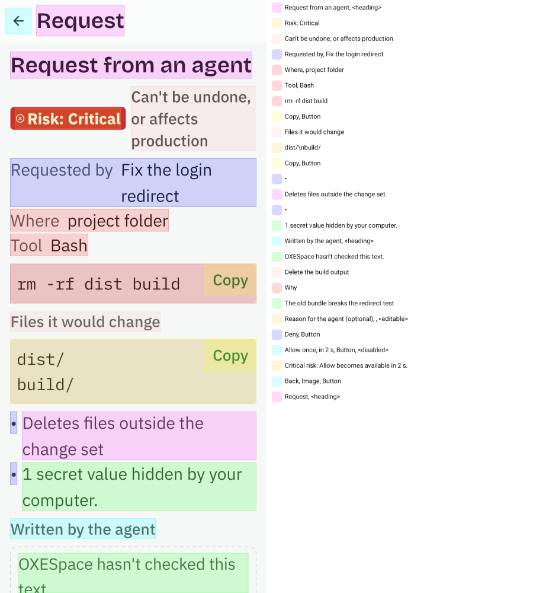

# F10 close: the phone for DESIGN (A70)

Goldens at `oxe/f10-plan` @ `e233a0d8` (CR-A42b re-record, then CR-F10-7/8/9; emulator gate run 42583379081: 32/32).
Every image is the committed golden, read from this branch (it is `e233a0d8` plus this file). Evidence only: never merged.

## Components

| Component | light | dark |
|---|---|---|
| `emptyState` |  |  |
| `notice` |  |  |
| `oxeButton` |  |  |
| `providerAvatar` |  |  |
| `statusGlyph` |  |  |

## Home (M1)

> **Design call 4:** revoked is a DANGER Notice; lapsed is a WARNING Notice (the pairing was never used before its window passed: it reads as "pair again", not as an attack).

| State | en · light | en · dark | pt-BR · light | pt-BR · dark |
|---|---|---|---|---|
| `connecting` |  |  |  |  |
| `incompatible` |  |  |  |  |
| `lapsed` |  |  |  |  |
| `offline` |  |  |  |  |
| `revoked` |  |  |  |  |
| `unpaired` |  |  |  |  |
| `unreachable` |  |  |  |  |

Accessibility (font scale): 

## Pairing (M2)

| State | en · light | en · dark | pt-BR · light | pt-BR · dark |
|---|---|---|---|---|
| `bad-code` |  |  |  |  |
| `contacting` |  |  |  |  |
| `local-network-ask` |  |  |  |  |
| `local-network-blocked` |  |  |  |  |
| `local-network-denied` |  |  |  |  |
| `paired` |  |  |  |  |
| `refused-by-computer` |  |  |  |  |
| `scanning` |  |  |  |  |
| `timed-out` |  |  |  |  |
| `unreachable` |  |  |  |  |
| `waiting` |  |  |  |  |
| `wrong-certificate` |  |  |  |  |

Accessibility (font scale): 

## Live (M3)

| State | en · light | en · dark | pt-BR · light | pt-BR · dark |
|---|---|---|---|---|
| `live-empty` |  |  |  |  |
| `live-reconnecting` |  |  |  |  |
| `live-requests` |  |  |  |  |
| `live-tasks` |  |  |  |  |
| `live-terminals` |  |  |  |  |
| `live-threads` |  |  |  |  |

Accessibility (font scale): 

## Agents (M7)

| State | en · light | en · dark | pt-BR · light | pt-BR · dark |
|---|---|---|---|---|
| `live-agents` |  |  |  |  |

## Conversation (M4)

| State | en · light | en · dark | pt-BR · light | pt-BR · dark |
|---|---|---|---|---|
| `diff` |  |  |  |  |
| `queued` |  |  |  |  |
| `timer-quiet` |  |  |  |  |
| `timer-working` |  |  |  |  |
| `latest-chip` |  |  |  |  |
| `thread-finished` |  |  |  |  |
| `thread-loading` |  |  |  |  |
| `thread-long` |  |  |  |  |
| `thread-working` |  |  |  |  |
| `thread` |  |  |  |  |

Accessibility (font scale): 

## Request (M5)

> **Design call 2:** Deny is the PRIMARY lead (accent fill) and Allow is SECONDARY, never danger red (§6, P1: a hurried tap denies). Cancel is SECONDARY and last.

| State | en · light | en · dark | pt-BR · light | pt-BR · dark |
|---|---|---|---|---|
| `request-desktop-only` |  |  |  |  |
| `request-gone` |  |  |  |  |
| `request-hidden-characters` |  |  |  |  |
| `request-question` |  |  |  |  |
| `request-risky` |  |  |  |  |
| `risk-levels` |  |  |  |  |

Accessibility (font scale):  

## Terminal (M6)

> **Design call 1:** the key row is SECONDARY OxeButtons (raised + border, 48 dp). The keys lose Plex Mono: OxeButton sets its own label style. **Design call 3:** the hidden pane and the unavailable conversation are INFO Notices with one action (Back / Show the screen); no golden shows them yet (see delta).

| State | en · light | en · dark | pt-BR · light | pt-BR · dark |
|---|---|---|---|---|
| `terminal-loading` |  |  |  |  |
| `terminal-read-only` |  |  |  |  |
| `terminal-tui` |  |  |  |  |
| `terminal-typing` |  |  |  |  |

## Settings (M8)

_No golden: ScreensSnapshotTest has no Settings case (see delta)._

## Delta against #627 HANDOFF-MOBILE.md

| Screen | Where it departs |
|---|---|
| Home | No computer card and no connecting skeleton (T-P1.3); the 1.4 layout with a Notice per problem. No OxeMark tile on the hero. |
| Pairing | No PairingStepper, Viewfinder or CodeBoxes (T-P1.4); the 1.4 layout with a Notice per failure (bad code WARNING, failed DANGER). |
| Live | Rows keep the text status: no StatusGlyph or ProviderAvatar (T-P1.5), and no WorkspaceChip on any row (T-P1.6; the component exists, unused). Empty lists are EmptyState. |
| Agents | StatusGlyph + ProviderAvatar rows and the five chips are built (CR-A43). Matches the handoff's flat list. |
| Conversation | No NowBanner, GateCard or StepsSummary. Problems are WARNING Notices; Respond and Steer are OxeButtons. |
| Request | No RiskChip (RiskLine is used). No CriticalDelayAllow ring: Allow is a disabled SECONDARY OxeButton plus the "becomes available in 2 s" caption (the hold itself is correct and proven on device). "No undo." uses noticeIcon(WARNING). Desktop-only and truncated are WARNING Notices. |
| Terminal | The View control is two TextButtons, not the SingleChoiceSegmentedButtonRow; it opens on Screen, not Conversation. No edge fade on the key row. No golden of the hidden-pane or unavailable-conversation Notice. |
| Settings | Built (theme + one switch per notification kind, from the live app bar menu), but with Material RadioButton and Switch rows, not Segmented / OxeSwitch / SettingsRow. **No golden at all**: ScreensSnapshotTest has no Settings case. |
| Icons | ic_threads, ic_requests, ic_terminal and ic_tasks are not replaced by OxeChat / OxeCode / Agora. |
